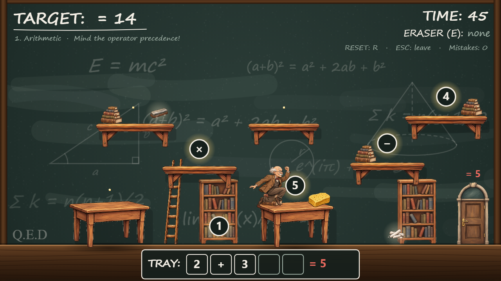
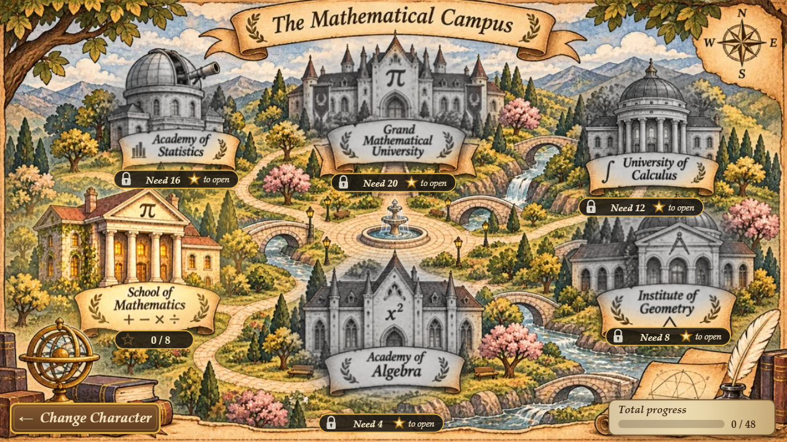
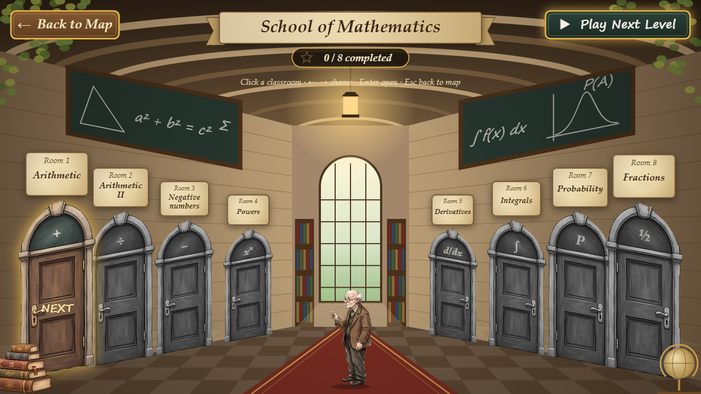
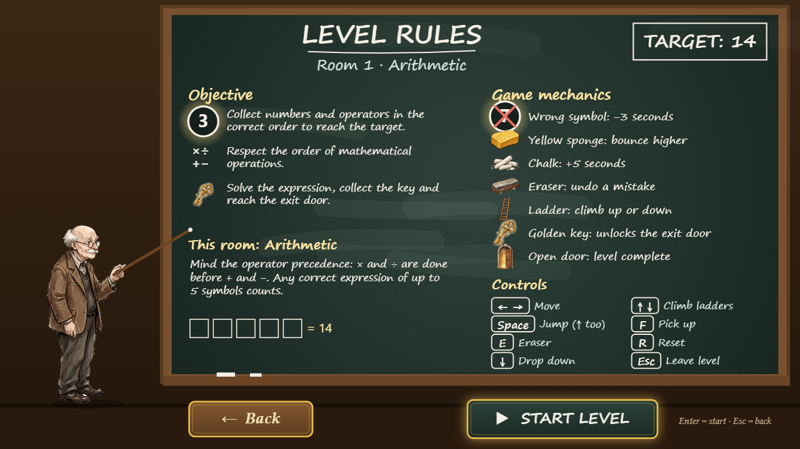

# Q.E.D. — Quod Erat Demonstrandum

**▶ Play it in your browser: <https://paclikO.github.io/qed-game/>**

*A mathematical puzzle-platformer in a hand-drawn "dark academia" world.*
An elderly professor jumps across desks, shelves and ladders of an old university and collects numbers
and operators **in the right order**, so that the equation in the tray equals the **TARGET**.
A correct equation earns a golden key – and the key opens the classroom door.



The game runs entirely in the browser: HTML5 Canvas + plain JavaScript (ES modules), no libraries,
no build step, no server – it is published with GitHub Pages straight from the `main` branch.

---

## How to play

1. **Choose your character** – Prof. Theodore or Prof. Margaret.
2. **Pick a school on the campus map.** Six schools, each with 8 classrooms (48 levels in total).
   Every completed room is worth ★; new schools open as you collect ★.
3. **Enter a classroom** in the school hallway. Completed rooms have open doors, the recommended next
   room glows gold.
4. **Read the rules** on the chalkboard – the timer only starts when you press *Start Level*.
5. **Build the equation**, take the key to the door, and see your stars on the results screen.

| School | Opens at | Topics |
|---|---|---|
| School of Mathematics | start | arithmetic & precedence, negative numbers, powers, derivatives, integrals, probability, fractions |
| Academy of Algebra | 4 ★ | linear equations, brackets, (a + b)², a² − b², polynomials, exponents, logarithms, sequences |
| Institute of Geometry | 8 ★ | angles, perimeter, area, Pythagoras, triangle area, circles, volume, polygons |
| University of Calculus | 12 ★ | limits, power rule, second derivative, chain rule, extrema, definite integrals, area, series |
| Academy of Statistics | 16 ★ | mean, median, range, combinations, permutations, binomial, conditional probability, variance |
| Grand Mathematical University | 20 ★ | mixed challenges and the Final Exam |

<p>
  
  
</p>

### Controls (keyboard; menus also work with the mouse)

| Key | Action |
|---|---|
| ← → | move |
| Space (or ↑) | jump – hold for a higher jump |
| X | dash – quick horizontal burst (works mid-air too, once per jump) |
| ↑ ↓ at a ladder | climb |
| ↓ | drop down through a shelf |
| F | pick up the symbol you are standing next to |
| E | eraser – put the last symbol back |
| R | restart the level (the clock keeps running) |
| Esc | leave the level |
| Enter | confirm / start / next level |

### Rules

- The equation is checked **while you build it**: a symbol is a mistake only if the target can no longer
  be reached with it, so most levels have several correct solutions.
- A mistake costs **3 seconds**, and the classroom starts to "fade" – distant symbols become harder to see,
  so you have to remember where things were.
- In arithmetic rooms any correct expression counts (`3 × −2 = −6` is fine); formula rooms
  (derivatives, integrals, …) need every slot filled.
- **Violet negative numbers** flip gravity for 3 seconds.
- **Yellow sponges** bounce you high, **chalk** gives +5 s, **erasers** let you undo a mistake
  (you start with none – find them in the room).
- Stars: ★★★ = no mistake and at least 40 % of the time left, ★★ = at most one mistake, ★ = solved.
- Progress is saved in your browser (`localStorage`).



---

## How it was made

The game was built iteratively together with an **AI coding agent** (Claude Code), following the brief in
[`AGENTS.md`](AGENTS.md) and the team's discussion:

1. **Python prototype** (`prototype/python/`, pygame) to try out the core idea: collect symbols, build an
   equation, penalties for wrong picks (time, a "fading" classroom, erasers).
2. **Browser version** in HTML5 Canvas following `AGENTS.md` (960×540, ES modules, no dependencies),
   then gravity-flipping negative numbers, ladders, sponges, chalk-dust effects and the key/door animation.
3. **Art**: concept art and sprites were generated with AI image tools by the team; `tools/cutout.py`
   cuts them out of their paper background into transparent PNGs (prompts in
   [`docs/art-prompts.md`](docs/art-prompts.md)).
4. **Game structure**: character selection, campus map, school hallways, rules screen, results,
   saved progress and unlocking of schools.
5. **Verification**: [`tools/verify-levels.html`](tools/verify-levels.html) tries *every* ordering of every
   level's symbols, compares the game's verdict with an independent calculation, and simulates jumps to
   check that every symbol, pickup and the door can be reached. It caught real bugs (correct expressions
   rejected in early levels, one unsolvable room) – all 48 levels now pass.

### Running locally

ES modules do not work from `file://`, so serve the folder with any static server:

```powershell
python -m http.server 8000
```

and open <http://localhost:8000>.
- **Developer Sandbox:** open <http://localhost:8000/dev.html> (or `/?dev=1`) to unlock all 6 schools and jump directly to any of the 48 levels without collecting stars, freeze the timer, inspect hitboxes/telemetry, grant erasers or the key, and test safely in isolated `localStorage` (`qed.progress.dev.v1`).
- **Level checker:** open <http://localhost:8000/tools/verify-levels.html>.

### Project structure

```
index.html, style.css        entry point
dev.html                     developer sandbox entry point (all levels unlocked, debug toolbar)
src/main.js                  game state machine, physics, input, HUD, main loop
src/dev.js                   developer sandbox toolbar, hitbox overlay & level jumper
src/screens.js               menus: character select, map, hallway, rules, results
src/ui.js                    UI kit (parchment, ribbons, buttons) + illustrated menu backgrounds
src/draw.js                  in-level drawing: chalkboard, furniture, symbols, characters, effects
src/levels.js                all 48 levels (room layouts + mathematics)
src/schools.js               schools, their rooms and unlock thresholds
src/mathEngine.js            exact fractions, expression/formula evaluation, solvability check
src/progress.js              saved progress
src/constants.js             physics and rule constants (penalty, gravity flip, jump height …)
src/assets.js                list of sprites (anything missing is drawn by code instead)
assets/                      sprites and the campus map
tools/                       cutout.py (sprite cut-out), verify-levels.html (level checker)
docs/                        art prompts, concept art, screenshots
prototype/python/            the first Python prototype
```

### Adding a level

Add a `room(...)` entry in `src/levels.js` (pick one of the eight layouts, a template with slots, a formula
and the symbols), put its id into a school in `src/schools.js`, and open `tools/verify-levels.html`
to check it is solvable and reachable.

### Notes on `AGENTS.md`

- Symbols are picked up with **F** instead of on touch (on touch they were hard to avoid);
  `PICKUP_ON_TOUCH = true` in `src/constants.js` switches it back.
- The game uses PNG sprites for a hand-illustrated look; without them it falls back to procedural drawing.
